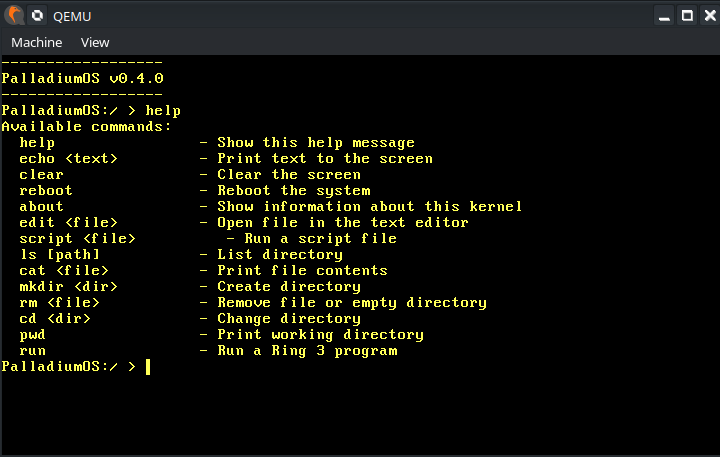

# PalladiumOS (Formerly FrostDOS)

## An OS (more of a kernel) coded entirely in Rust



## Warning
Currently compling using 'cargo build' is broken for some Goddamn reason so it only works on my pc I really dont know why.

## Notice
I do want to make things clear and say i used AI for some parts of my code as this is my first kernel so I dont understand much yet

i used AI for
* the filesystem
* the shell
* text editor (as a guide)
* finding bugs
* guiding for implimenting stuff
* ring 3/usermode stuff

## Features
* Basic Shell
* Heap Allocation
* Keyboard Input
* Filesystem
* Scripting
* Text Editor
* Ring 3/Usermode

## Programs
User programs run in ring 3 and are started with `run <name> [args...]` (`run` alone lists them):
* hello - prints a greeting
* echo - prints its arguments (`-n` for no newline)
* cat - prints files, or what you type until Ctrl-D
* ls - lists directories (`-a` for hidden entries, `-l` for type and size)
* mkdir - creates directories (`-p` for parents)
* rmdir - removes empty directories
* rm - removes files (`-r` for directories, `-f` to ignore missing files)
* touch - creates empty files
* pwd - prints the working directory
* env - prints the environment
* clear - clears the screen
* reboot / poweroff - restarts or turns off the machine
* sh - the shell
* edit - full-screen text editor (arrows, Home/End, PageUp/PageDown; Ctrl+S save, Ctrl+Q quit)
* about - information about PalladiumOS
* sleep - waits for a number of seconds (`sleep 0.5` works)
* kill - sends a signal (`kill -9 PID`, `kill -l`)
* uptime - time since boot
* grep - prints matching lines (`-i -v -n -c -q -F`; `.` `*` `^` `$` patterns)
* wc - counts lines, words and bytes (`-l -w -c`)
* head / tail - first or last lines (`-n N`)
* sort - sorts lines (`-r -n -u`)
* uniq - collapses repeated lines (`-c -d`)
* tee - copies input to the screen and to files (`-a` appends)
* yes - repeats a line forever (try `yes | head -n 3`)
* uname - prints system info (`-a`, `-s`, `-n`, `-r`, `-v`, `-m`)

### Writing a Program
Programs are written in Rust in `userland/src/bin/` using `userlib` (syscalls, `print!`/`println!`, arguments, environment, and a heap so `Vec`, `String` and `Box` work).
Every file there is built and bundled into the kernel automatically by `build.rs`:

```rust
#![no_std]
#![no_main]

use userlib::println;

userlib::entry!(main);

fn main(args: userlib::Args) -> i32 {
    println!("Hello from {}", args.get(0).unwrap_or("?"));
    0 // exit status
}
```

Programs are static ELF executables loaded at `0x8000000000`, with a 64 KiB stack (plus a guard page) and the standard System V startup stack (`argc`, `argv`, `envp`, `auxv`).
Files named `test_*` are used by the test suite and hidden from `run`.

## Syscalls
PalladiumOS uses the Linux x86_64 syscall ABI (`rax` = number, arguments in `rdi`, `rsi`, `rdx`, `r10`, `r8`, `r9`, result in `rax`, negative errno on failure), entered with `int 0x80`.

| # | Name | Status |
|---|------|--------|
| 0 | read | yes (stdin is line-buffered, Ctrl-D is end-of-file) |
| 1 | write | yes |
| 2 | open | yes (`O_CREAT`, `O_EXCL`, `O_TRUNC`, `O_APPEND`, `O_DIRECTORY`) |
| 3 | close | yes |
| 4 | stat | yes |
| 5 | fstat | yes |
| 6 | lstat | yes (same as stat, no symlinks) |
| 8 | lseek | yes |
| 22 | pipe | yes |
| 12 | brk | yes (the heap behind `userlib`'s allocator) |
| 13 | rt_sigaction | `SIG_DFL` and `SIG_IGN` only (no handlers yet) |
| 14 | rt_sigprocmask | accepted, masks not implemented |
| 16 | ioctl | console: `TCGETS`/`TCSETS` (raw and cooked mode), `TIOCGWINSZ`, `TIOCGPGRP`/`TIOCSPGRP` |
| 24 | sched_yield | yes |
| 32 | dup | yes |
| 33 | dup2 | yes |
| 35 | nanosleep | yes (55 ms timer resolution) |
| 39 | getpid | yes |
| 57 | fork | yes (copies the whole address space) |
| 58 | vfork | yes (same as fork, which POSIX allows) |
| 59 | execve | yes (static ELF executables) |
| 60 | exit | yes |
| 61 | wait4 | yes (`WNOHANG`; no rusage) |
| 62 | kill | yes (pid, process group, or -1 for all) |
| 72 | fcntl | `F_DUPFD`, `F_GETFD`/`F_SETFD` (close-on-exec), `F_GETFL` |
| 109 | setpgid | yes |
| 111 | getpgrp | yes |
| 121 | getpgid | yes |
| 63 | uname | yes |
| 79 | getcwd | yes |
| 80 | chdir | yes |
| 83 | mkdir | yes |
| 84 | rmdir | yes |
| 87 | unlink | yes |
| 110 | getppid | yes |
| 169 | reboot | yes (restart, power off, halt) |
| 217 | getdents64 | yes |
| 228 | clock_gettime | yes (time since boot) |
| 231 | exit_group | yes |
| 257 | openat | yes |
| 292 | dup3 | yes (`O_CLOEXEC`) |
| 293 | pipe2 | yes (`O_CLOEXEC`) |

## Processes
Every program runs as a process with its own address space, kernel stack, open files and working directory.
The scheduler is preemptive round-robin: the timer switches between processes running in ring 3.
Programs can start other programs with `fork` + `execve` and wait for them with `wait4` (`userlib::spawn` wraps this).
The kernel shell is task 0: `run` starts a program as its child and waits for it (and anything it started) to finish.
Orphaned processes are handed to the kernel, which reaps them. Up to 32 processes can exist at once.

Open files work like POSIX: an fd refers to a shared open file description, so after `fork` or `dup` both fds share one file offset. Pipes hold 16 KiB; readers wait for data and get end-of-file when every writer has closed, writers wait for room and get SIGPIPE/`EPIPE` when no reader is left. `O_CLOEXEC` fds are closed by `execve`.

Signals: Ctrl-C sends SIGINT to the foreground process group (the shell gives each command its own group, so only the command is interrupted). Default actions are supported (terminate or ignore) and `SIG_IGN`; signal handlers are not yet.
The console understands the usual ANSI escape sequences (cursor movement, clearing, colors and reverse video), so full-screen programs like `edit` work.

Programs live in `/bin` as ordinary files, installed at boot: `run ls` runs `/bin/ls`, and `run /path/to/program` runs any ELF file.

## Running the Tests
`cargo test` boots each test kernel in QEMU (no window) and reports results over serial.
* `tests/usermode.rs` - ring 3 programs, syscalls, exit statuses and fault handling
* `tests/filesystem.rs` - the filesystem and shell commands
* `tests/heap_allocation.rs`, `tests/stack_overflow.rs`, `tests/should_panic.rs`, `tests/basic_boot.rs` - kernel basics

The tiny user programs used by the tests live in `tests/user_progs` (`./build.sh` rebuilds them).

## Instructions for Running the Kernel
* Install QEMU
* Download the Latest Release
* Run this Command: qemu-system-x86_64 -drive format=raw,file=[location of BIN file
* The system is running

## The Shell
PalladiumOS boots into `/bin/sh`, a POSIX-style shell that runs in userland as a normal process.

* Run programs by name (`ls -l /bin`) or by path (`/bin/echo hi`); names are looked up in `$PATH`
* Quoting: `'single'`, `"double with $VARS"`, `\` escapes, `# comments`
* Variables: `x=1`, `$x`, `${x}`, `$?` (last exit status), `$$`, `$#`, `$0`-`$9`, `~`
* Environment: `export NAME=value`, `unset NAME`, `NAME=value command` for one command
* Pipelines: `ls /bin | grep ^s | wc -l` (Ctrl-C stops the whole pipeline)
* Lists: `cmd1; cmd2`, `cmd1 && cmd2`, `cmd1 || cmd2`, background jobs with `cmd &`
* Redirection: `> file`, `>> file`, `< file`, `2> file`, `2>&1`
* Scripts: `sh script.sh args...`, `sh -c 'commands'`, `. file` / `source file`
* Builtins: `cd`, `pwd`, `exit`, `export`, `unset`, `set`, `wait`, `jobs`, `kill` (understands `%1`), `.`, `source`, `help`, `true`, `false`, and `run`/`script` like the kernel shell
* Keys: Up/Down for history, Left/Right/Home/End to edit the line, Tab completes commands and file names, Ctrl-C interrupts the running program (or clears the line), Ctrl-D exits, Ctrl-L clears the screen

Not yet: wildcards, `if`/`while`/`for`, functions, `( subshells )`.

### Kernel Shell
Typing `exit` in `sh` (or Ctrl-D) drops to the built-in kernel shell, which is kept as a fallback (background jobs are sent SIGHUP). Type `run sh` to go back. Kernel shell commands:
* echo                - Echos back your Message
* about               - Kernel info
* clear               - Clear the screen
* help                - Show the help message
* reboot              - Reboots the system
* script <file>       - Runs script
* edit <file>         - Open file in the kernel's text editor
* ls <path>           - List directory
* cat <file>          - Print file contents
* mkdir <dir>         - Create directory
* rm <file>           - Remove file or empty directory
* cd  <dir>           - Change directory
* pwd                 - Print working directory
* run <program>       - Run a program from /bin (or a path)

## Credits
Philipp Oppermann for his 'Writing an OS in Rust' guide
