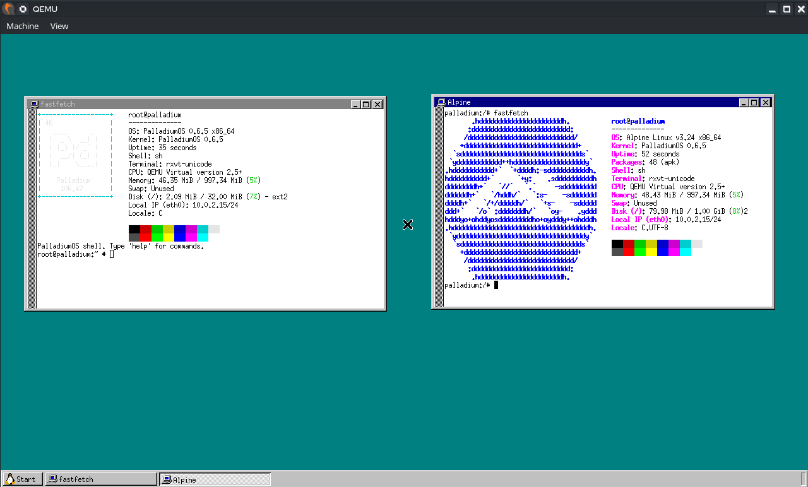
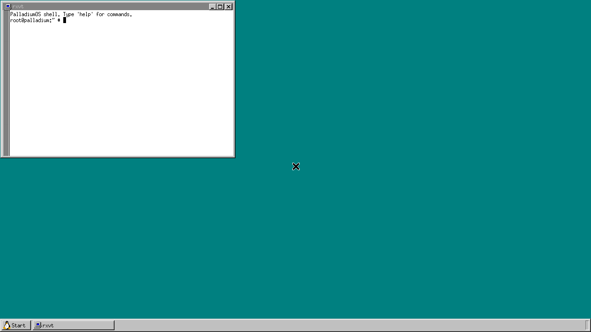

# PalladiumOS (Formerly FrostDOS)

## An OS (more of a kernel) coded entirely in Rust


## Notice
> [!WARNING]
> I do want to make things clear and say I used AI for a lot of my code, as this is my first kernel, so I don't understand much yet.
>
> Up to 0.4.0, I used AI for:
> * The filesystem
> * The shell
> * Text editor (as a guide)
> * Finding bugs
> * Guiding for implementing stuff
> * Ring 3/usermode stuff
>
> From 0.5.0 on (0.6.x too), almost all of the new code was written with AI (Claude Code), including:
> * The Linux-compatible system calls and the program loader
> * The userland: the Rust programs, `/bin/sh` and its scripting
> * Processes, the scheduler, `fork`/`exec`, copy-on-write, threads and signals
> * The ext2 filesystem, the VFS, `/proc`, `/dev` and the disk driver
> * Users, permissions, login and passwords
> * Running C programs with musl, and the ports (BusyBox, Lua, dash, MicroPython, fastfetch, TinyCC)
> * Networking: the network card driver, TCP/IP and sockets
> * The higher-half kernel, the boot log, the tests and most of this README
> * UEFI booting and the framebuffer console, the AHCI and USB keyboard drivers, running Alpine Linux, and the X Window System (the kernel's side, and the ports: TinyX, rxvt, evilwm, fvwm95, IceWM, the X.Org programs, xterm, Links, Tcl/Tk, Vim, xfm and the games)
> * SMP (every CPU core), POSIX timers, and the shell's here-documents, aliases and `local`

## Features
* **Linux-compatible system calls** (the x86_64 ABI): ordinary Linux programs run unchanged, static or dynamically linked (with musl's or glibc's own dynamic linker), including C programs built with an unmodified [musl](https://musl.libc.org) libc
* **More than one CPU core** (SMP): programs run on every core at once (`cargo run` gives QEMU up to 4). See [CPU Cores](#cpu-cores)
* **Processes**: preemptive multitasking, `fork` (copy-on-write) / `execve` / `wait4`, threads (pthreads, `futex`), signals with handlers and job control, POSIX timers, `epoll`, `eventfd`, `timerfd`, `signalfd` and `inotify`, shared memory (`MAP_SHARED`, `/dev/shm`, POSIX semaphores between processes), and memory on demand (programs can reserve gigabytes and only use what they touch; programs bigger than the kernel's heap load piece by piece)
* **Hardware**: boots with BIOS or UEFI, starts every CPU core (ACPI, local APICs), a framebuffer console (1280x720 in QEMU), IDE and AHCI (SATA) disks, PS/2 and USB (xHCI) keyboards, a PS/2 mouse, the RTL8139 network card, an AC'97 sound card (OSS: `/dev/dsp`, `/dev/mixer`; see [Sound](#sound))
* **Users and permissions**: login, passwords, POSIX file permissions, setuid programs, `su`
* **Filesystems**: ext2 on a virtual disk (saved across reboots), a VFS with mounts, `/proc`, `/dev`, pipes, symbolic and hard links
* **Networking**: an RTL8139 driver, TCP/IP (smoltcp), DHCP, DNS, BSD sockets (TCP, UDP, raw, Unix-domain) and netlink, and an **SSH server** (Dropbear): log in from your own terminal with `ssh -p 2222 root@localhost`; a web server in PalladiumOS on port 80 (Apache, `busybox httpd`) is at `http://localhost:8080`
* **Alpine Linux**: `alpine` sets up a real Alpine root filesystem on its own disk, where `apk add` installs Alpine's packages and they run on PalladiumOS: Python (including `multiprocessing`), Node.js, git, curl, vim, htop, and a web stack: Apache with PHP, SQLite and MariaDB
* **The X Window System**, native: an X server (TinyX's `Xfbdev`) on the framebuffer, with the keyboard and a PS/2 mouse, window managers (IceWM by default, with a taskbar, a menu, workspaces and themes; fvwm95, the Windows 95 look; evilwm), terminals (xterm, rxvt), the classic X.Org programs (xclock, xcalc, xedit, xeyes...), a web browser (Links), a file manager (xfm), Vim, Tcl/Tk, and games (DOOM with Freedoom, XBoard chess, xjewel). See [X](#the-x-window-system)
* **Terminals**: pseudo-terminals (`/dev/ptmx`, `/dev/pts/N`), sessions and controlling terminals, job control
* **A userland**: a POSIX-style shell, about 55 of PalladiumOS's own tools, and ported software: BusyBox, Lua, dash, MicroPython, fastfetch, TinyCC (a C compiler that runs inside PalladiumOS), Dropbear SSH, Vim, Tcl/Tk, and the X programs (TinyX, IceWM, fvwm95, xterm, Links, xfm, the X.Org programs, games)
* **A Linux-style boot log** with `[  OK  ]` lines, and `dmesg`

## Programs
PalladiumOS's own tools, written in Rust, live in `/bin` and run from the shell by name (`ls -l /bin`). Where BusyBox's version is clearly better, `/bin/NAME` runs BusyBox's and the one below moves to `/bin/palladium/NAME` (see [Ported Software](#ported-software)):
* hello - prints a greeting
* echo - prints its arguments (`-n` for no newline)
* cat - prints files, or what you type until Ctrl-D
* ls - lists directories (`-a` for hidden entries, `-l` for type and size)
* mkdir - creates directories (`-p` for parents)
* rmdir - removes empty directories
* rm - removes files (`-r` for directories, `-f` to ignore missing files)
* touch - creates empty files
* pwd - prints the working directory
* env - prints the environment
* clear - clears the screen
* reboot / poweroff - restarts or turns off the machine
* sh - the shell
* edit - full-screen text editor (arrows, Home/End, PageUp/PageDown; Ctrl+S save, Ctrl+Q quit)
* about - information about PalladiumOS
* sleep - waits for a number of seconds (`sleep 0.5` works)
* kill - sends a signal (`kill -9 PID`, `kill -l`)
* uptime - time since boot
* dmesg - the boot log again (`-n` without colors)
* date - the date and time (`date +%s` for seconds since 1970)
* mv / cp - move and copy files (`cp -r` for directories; `mv` works across filesystems)
* ln - hard links, or symbolic links with `-s`; readlink shows where a link points
* chmod - permissions, octal (`755`) or symbolic (`u+x,go-w`)
* df / du - free disk space, and space used by files (`-h` for K/M/G, `du -s` totals)
* stat - a file's type, size, inode, links, permissions and time
* ps - list processes (PID, parent, state, CPU time, memory, command)
* top - live process view, refreshed every second (`q` quits)
* free - memory use (`-h` for M/G); mount - what's mounted where
* pgrep / pkill - find or signal processes by name (`-l`, `-x`, `pkill -9 name`)
* sync - writes cached data to the disk
* grep - prints matching lines (`-i -v -n -c -q -F`; `.` `*` `^` `$` patterns)
* wc - counts lines, words and bytes (`-l -w -c`)
* head / tail - first or last lines (`-n N`)
* sort - sorts lines (`-r -n -u`)
* uniq - collapses repeated lines (`-c -d`)
* tee - copies input to the screen and to files (`-a` appends)
* yes - repeats a line forever (try `yes | head -n 3`)
* uname - prints system info (`-a`, `-s`, `-n`, `-r`, `-v`, `-m`)

### Writing a Program
Programs are written in Rust in `userland/src/bin/` using `userlib` (syscalls, `print!`/`println!`, arguments, environment, and a heap so `Vec`, `String` and `Box` work).
Every file there is built and bundled into the kernel automatically by `build.rs`:

```rust
#![no_std]
#![no_main]

use userlib::println;

userlib::entry!(main);

fn main(args: userlib::Args) -> i32 {
    println!("Hello from {}", args.get(0).unwrap_or("?"));
    0 // exit status
}
```

Programs are static ELF executables loaded at `0x8000000000`, with a stack that grows on demand up to 1 MiB and the standard System V startup stack (`argc`, `argv`, `envp`, `auxv`).
Files named `test_*` are used by the test suite and hidden from `run`.

## Syscalls
PalladiumOS uses the Linux x86_64 syscall ABI (`rax` = number, arguments in `rdi`, `rsi`, `rdx`, `r10`, `r8`, `r9`, result in `rax`, negative errno on failure), entered with `int 0x80` (PalladiumOS's own programs) or the `syscall` instruction (what Linux programs and musl use).

| # | Name | Status |
|---|------|--------|
| 0 | read | yes (stdin is line-buffered, Ctrl-D is end-of-file) |
| 1 | write | yes |
| 2 | open | yes (`O_CREAT`, `O_EXCL`, `O_TRUNC`, `O_APPEND`, `O_DIRECTORY`) |
| 3 | close | yes |
| 4 | stat | yes |
| 5 | fstat | yes |
| 6 | lstat | yes |
| 7 / 271 | poll, ppoll | yes (pipes, sockets, terminals; files are always ready) |
| 8 | lseek | yes |
| 9 / 10 / 11 | mmap, mprotect, munmap | anonymous (memory comes when a page is first used, so reserving gigabytes is free), private file mappings, shared mappings (`MAP_SHARED`: anonymous memory shared with forked children, and files such as `/dev/shm`, written back on `msync` and when unmapped), and the screen itself (`/dev/fb0`) |
| 12 | brk | yes (the heap behind `userlib`'s allocator) |
| 13 | rt_sigaction | yes (handlers, `SA_RESTART`, `SA_NODEFER`, `SA_RESETHAND`, `SA_NOCLDSTOP`, `sa_mask`) |
| 14 | rt_sigprocmask | yes |
| 15 | rt_sigreturn | yes |
| 16 | ioctl | terminals: `TCGETS`/`TCSETS` (raw and cooked mode), `TIOCGWINSZ`/`TIOCSWINSZ`, `TIOCGPGRP`/`TIOCSPGRP`, `TIOCSCTTY`/`TIOCNOTTY`, `TIOCGSID`, `TCFLSH`, and for pseudo-terminals `TIOCGPTN`/`TIOCSPTLCK`; the console's virtual terminal and keyboard ioctls (`VT_GETSTATE`, `VT_OPENQRY`, `VT_SETMODE`, `VT_ACTIVATE`..., `KDSETMODE` for graphics mode, `KDSKBMODE` for raw keycodes, `KDGKBENT` for the keymap, the LEDs and the bell); the framebuffer `/dev/fb0` (`FBIOGET_VSCREENINFO`, `FBIOGET_FSCREENINFO`, `FBIOPUT_VSCREENINFO`, `FBIOGETCMAP`/`FBIOPUTCMAP`, `FBIOPAN_DISPLAY`, `FBIOBLANK`); sound: OSS's `SNDCTL_DSP_*` on `/dev/dsp` and `SOUND_MIXER_*` on `/dev/mixer` (see [Sound](#sound)); pipes and sockets: `FIONBIO`, `FIONREAD`; sockets: the interface queries (`SIOCGIFNAME`, `SIOCGIFADDR`...) |
| 17 / 18 | pread64, pwrite64 | yes |
| 19 / 20 | readv, writev | yes |
| 21 | access | yes |
| 22 | pipe | yes |
| 23 / 270 | select, pselect6 | yes (on top of poll) |
| 24 | sched_yield | yes |
| 25 | mremap | answers like Linux (`ENOMEM`, or `EFAULT` outside memory); libc then allocates and copies |
| 26 | msync | writes shared file mappings back to their files |
| 32 | dup | yes |
| 33 | dup2 | yes |
| 34 | pause | yes |
| 35 | nanosleep | yes (10 ms timer resolution) |
| 36/38 | getitimer, setitimer | `ITIMER_REAL` |
| 37 | alarm | yes |
| 39 | getpid | yes |
| 40 | sendfile | yes |
| 41-55, 288 | socket, connect, accept, sendto, recvfrom, sendmsg, recvmsg, shutdown, bind, listen, getsockname, getpeername, socketpair, setsockopt, getsockopt, accept4 | `AF_INET` TCP, UDP and raw IP; `AF_UNIX` stream and datagram |
| 56 | clone | fork, vfork-style `CLONE_VM \| CLONE_VFORK` (what `posix_spawn`, `system` and `popen` use), and threads (`CLONE_THREAD` with `SETTLS`, `PARENT_SETTID`, `CHILD_SETTID`, `CHILD_CLEARTID`) |
| 57 | fork | yes (copy-on-write: pages are copied only when written) |
| 58 | vfork | yes (same as fork, which POSIX allows) |
| 59 | execve | yes (ELF executables, static or dynamically linked: the kernel loads the `PT_INTERP` dynamic linker too) |
| 60 | exit | yes |
| 61 | wait4 | yes (`WNOHANG`, `WUNTRACED`, `WCONTINUED`, process groups, rusage) |
| 62 | kill | yes (pid, process group, or -1 for all; `EPERM` for other users' processes) |
| 63 | uname | yes |
| 72 | fcntl | `F_DUPFD`(`_CLOEXEC`), `F_GETFD`/`F_SETFD` (close-on-exec), `F_GETFL`/`F_SETFL` (`O_NONBLOCK`, `O_ASYNC`), `F_SETOWN`/`F_GETOWN` (who gets `SIGIO` when keyboard or mouse input arrives), record locks (`F_SETLK` & co.: always granted) |
| 73 | flock | always granted (nobody is made to wait) |
| 76 / 77 | truncate, ftruncate | yes |
| 79 | getcwd | yes |
| 80 | chdir | yes |
| 81 | fchdir | yes |
| 82 | rename | yes (also renameat, renameat2 without flags) |
| 83 | mkdir | yes |
| 84 | rmdir | yes |
| 86 | link | yes (also linkat; not on in-memory filesystems) |
| 87 | unlink | yes |
| 88 | symlink | yes (also symlinkat) |
| 89 | readlink | yes (also readlinkat) |
| 90 | chmod | yes (also fchmod, fchmodat) |
| 92/93/94/260 | chown, fchown, lchown, fchownat | yes |
| 95 | umask | yes |
| 96 | gettimeofday | yes |
| 97 / 302 | getrlimit, prlimit64 | reports the limits (setting is ignored) |
| 99 | sysinfo | uptime, memory, number of processes |
| 100 | times | the process's CPU time, ticks since boot |
| 102/104/107/108 | getuid, getgid, geteuid, getegid | yes |
| 105/106/113/114/117/119 | setuid, setgid, setreuid, setregid, setresuid, setresgid | yes (POSIX rules) |
| 109 | setpgid | yes |
| 110 | getppid | yes |
| 111 | getpgrp | yes |
| 112 / 124 | setsid, getsid | yes |
| 115/116 | getgroups, setgroups | yes |
| 118/120 | getresuid, getresgid | yes |
| 121 | getpgid | yes |
| 125 | capget | no capabilities (root is uid 0) |
| 127 | rt_sigpending | yes |
| 128 | rt_sigtimedwait | yes (sigwait; a signal blocked where it was sent goes to a thread waiting for it) |
| 130 | rt_sigsuspend | yes |
| 131 | sigaltstack | remembered (handlers run on the normal stack) |
| 132 / 235 | utime, utimes | the modification time |
| 135 | personality | Linux only |
| 137 | statfs | yes (also fstatfs) |
| 140 / 141 | getpriority, setpriority | every process has nice 0 |
| 143-148 | sched_getparam, sched_setscheduler, sched_getscheduler, sched_get_priority_max/min, sched_rr_get_interval | normal scheduling (`SCHED_OTHER`, priority 0); real-time policies accepted from root |
| 149-152 / 325 | mlock, munlock, mlockall, munlockall, mlock2 | accepted (no swap: memory never leaves RAM) |
| 157 | prctl | `PR_SET_NAME`/`PR_GET_NAME`; the precautionary options are accepted |
| 158 | arch_prctl | FS/GS base (thread-local storage) |
| 161 | chroot | yes (root only; paths, symlinks, `..` and the program interpreter stay inside) |
| 162 | sync | yes |
| 165 / 166 | mount, umount2 | `proc`, `devtmpfs` and `tmpfs` (root only; disks are mounted at boot) |
| 169 | reboot | yes (restart, power off, halt; syncs first) |
| 170 | sethostname | root; `/etc/hostname` is read at boot |
| 186 | gettid | yes (`getpid` is the process, `gettid` the thread) |
| 187 | readahead | accepted (a hint) |
| 200/234 | tkill, tgkill | yes |
| 201 | time | yes |
| 202 | futex | `WAIT`, `WAKE` (and `_BITSET`), `REQUEUE`, `CMP_REQUEUE`, timeouts |
| 203 / 204 | sched_setaffinity, sched_getaffinity | every core (`nproc` counts them); setting is accepted, processes still run on any core |
| 206 | io_setup | not supported (Linux native AIO: callers fall back) |
| 213 / 291 | epoll_create, epoll_create1 | yes |
| 217 | getdents64 | yes |
| 218 | set_tid_address | yes |
| 228 | clock_gettime | yes (time since boot) |
| 230 | clock_nanosleep | yes (`TIMER_ABSTIME` too) |
| 231 | exit_group | yes |
| 232 / 281 / 441 | epoll_wait, epoll_pwait, epoll_pwait2 | level-triggered (edge-triggered requests too), `EPOLLONESHOT`, timeouts |
| 233 | epoll_ctl | `ADD`, `MOD`, `DEL` (regular files refused, as on Linux) |
| 247 | waitid | `P_ALL`, `P_PID`, `P_PGID`; `WEXITED`, `WSTOPPED`, `WCONTINUED`, `WNOHANG`, `WNOWAIT` |
| 251 / 252 | ioprio_set, ioprio_get | accepted (no I/O priorities) |
| 253 / 254 / 255 / 294 | inotify_init, inotify_add_watch, inotify_rm_watch, inotify_init1 | create, modify, close, delete, move (with cookies), attrib; watches on files and directories |
| 257 | openat | yes |
| 258-263 | mkdirat, newfstatat, unlinkat | yes |
| 275 | splice | between a pipe and another fd |
| 277 | sync_file_range | accepted |
| 280 | utimensat | modification time |
| 282 / 289 | signalfd, signalfd4 | yes (readable in poll/epoll) |
| 222-226 | timer_create, timer_settime, timer_gettime, timer_getoverrun, timer_delete | POSIX timers: one-shot and repeating, relative or absolute, on CLOCK_REALTIME/MONOTONIC; a signal to the process or a thread (`SIGEV_SIGNAL`, `SIGEV_THREAD_ID`, so musl's `SIGEV_THREAD` works), `SIGEV_NONE`; `sigwaitinfo` reports `SI_TIMER` with the timer's value (10 ms resolution) |
| 283 / 286 / 287 | timerfd_create, timerfd_settime, timerfd_gettime | one-shot and repeating, relative or absolute (10 ms resolution) |
| 284 / 290 | eventfd, eventfd2 | yes (`EFD_SEMAPHORE`, `EFD_NONBLOCK`) |
| 285 | fallocate | growing a file |
| 292 | dup3 | yes (`O_CLOEXEC`) |
| 293 | pipe2 | yes (`O_CLOEXEC`, `O_NONBLOCK`) |
| 295 / 296 / 327 / 328 | preadv, pwritev, preadv2, pwritev2 | yes |
| 306 | syncfs | a full sync |
| 309 | getcpu | the core it runs on |
| 318 | getrandom | yes (RDRAND when available) |
| 319 | memfd_create | an anonymous file in memory (up to 4 MiB) |
| 324 | membarrier | yes (a process's threads never run at the same moment: every command is already satisfied) |
| 326 | copy_file_range | yes |
| 332 | statx | yes |
| 436 | close_range | closing, or `CLOSE_RANGE_CLOEXEC` |
| 452 | fchmodat2 | `AT_SYMLINK_NOFOLLOW`, `AT_EMPTY_PATH` |

## Networking
PalladiumOS has TCP/IP: a driver for the RTL8139 network card (what `cargo run` gives QEMU, on its user network), the [smoltcp](https://github.com/smoltcp-rs/smoltcp) stack, and BSD sockets.
* `eth0` is configured by DHCP at boot (QEMU: 10.0.2.15, gateway 10.0.2.2, DNS 10.0.2.3, written to `/etc/resolv.conf`); `lo` (127.0.0.1) works with or without a card. `/etc/hosts` has `localhost`.
* Sockets: `AF_INET` TCP, UDP and raw IP: `socket`, `bind`, `listen`, `accept`/`accept4`, `connect`, `send`/`recv`(`to`/`from`/`msg`), `shutdown`, `getsockname`/`getpeername`, `setsockopt`/`getsockopt` (`SO_ERROR`), `poll`, non-blocking mode (`SOCK_NONBLOCK`, `O_NONBLOCK`, `FIONBIO`, `MSG_DONTWAIT`), `EPIPE`/`SIGPIPE`. Closing with unread data resets the connection, as on Linux.
* Raw sockets (`SOCK_RAW`, root only, as Linux needs `CAP_NET_RAW`) give packets with their IPv4 header; sent data gets a header from the kernel unless `IP_HDRINCL` is set (or the protocol is `IPPROTO_RAW`). PalladiumOS answers pings itself.
* So BusyBox's `wget`, `nslookup`, `nc`, `telnet`, `httpd` and `ping` (as root), MicroPython's `socket`, and C programs with musl's resolver work: `wget http://example.com/` downloads a page, `ping example.com` gets answers, and the host is reachable at 10.0.2.2.
* Unix-domain sockets (`AF_UNIX`), for programs on the same machine: stream and datagram, `socketpair`, names that are paths (`bind` makes the file; `connect` needs write permission on it) or abstract (`sun_path` starting with a NUL), `SO_PEERCRED`, non-blocking mode and `poll`, and passing file descriptors to another process (`SCM_RIGHTS`, arriving with the data they were sent with). A bound name is a socket file (`ls -l` shows `s`, `test -S` finds it; `open` on it fails with `ENXIO`, as on Linux).
* Netlink (`AF_NETLINK`, read-only): programs can list the interfaces, their addresses and the routes the way Linux answers, so `getifaddrs()`, BusyBox's `ip addr` / `ip link` / `ip route` and fastfetch's Local IP work. The interface `ioctl`s (`SIOCGIFNAME`, `SIOCGIFINDEX`, `SIOCGIFADDR`, `SIOCGIFMTU`, `SIOCGIFHWADDR`...) work too. Changing settings this way isn't supported.
* Not yet: IPv6, more than one card type.

## Threads
Programs can have threads: musl's pthreads (mutexes, condition variables, semaphores, `pthread_join`, `pthread_kill`, thread-local storage) works unchanged, and MicroPython's `_thread` too. A thread shares its process's memory, open files, working directory and signal handlers; it has its own registers, stack, TLS, signal mask and pending signals. `kill` sends to a process (to a thread that isn't blocking the signal), `tgkill` to one thread. `exit` ends a thread, `exit_group` (or a fatal signal) the whole process; a process whose first thread called `pthread_exit` lives until its last thread ends. Limits: a process's threads take turns (they run one at a time, while separate programs run on every core: see [CPU Cores](#cpu-cores)), and only a process's first thread may `execve`.

## CPU Cores
PalladiumOS starts every CPU core the firmware lists (ACPI's MADT): the first one sends the others INIT and startup signals through its local APIC, and each runs a small trampoline below 1 MiB from 16-bit real mode into 64-bit mode, then takes processes from the same scheduler. `nproc`, `/proc/cpuinfo`, `/proc/stat`, htop and `getcpu` see them. `cargo run` gives QEMU as many cores as your machine has, up to 4 (`cargo run -- -smp 2` for another number); the release images boot with any number (`-smp 4` to QEMU).

* Programs run on all cores at the same time: four CPU-bound programs take about as long as one (3.2 times faster than on one core in QEMU).
* The kernel runs on one core at a time: a core takes the big kernel lock on its way into the kernel (a system call, an interrupt or fault from a program) and lets it go on its way back (or while it waits, and for a moment whenever it looks for something else to run and finds nothing), so the kernel's code stays as simple as on one CPU. System-call-heavy work doesn't get faster yet.
* A process's threads take turns: two threads of one address space never run at the same moment, so no core ever uses page mappings another core has changed (no TLB shootdowns needed yet).
* The first core keeps the PIT timer and the devices' interrupts (through its APIC in virtual-wire mode); the others have their APIC's timer, for preemption.
* `PALLADIUM_SMP=4 cargo test` runs the test suite's programs on 4 cores; `tests/smp.rs` checks starting them.

## C Programs (musl libc)
C programs run on PalladiumOS with an unmodified [musl](https://musl.libc.org) libc: PalladiumOS speaks the Linux x86_64 syscall interface musl was written for, saves the SSE registers programs use, supports thread-local storage, `mmap`, and gives programs the aux vector libc's startup reads.

```sh
tools/build-musl.sh        # downloads musl 1.2.5 (checksum-verified) and builds it into target/musl
cargo run                  # build.rs now compiles every userland-c/*.c into /bin
```

Then run `chello` or `test_libc` (a test of stdio, malloc, files, mmap, fork/exec, signals, time...) in the shell. Add a program by putting `NAME.c` in `userland-c/`, or compile one yourself with `target/musl/bin/palladium-cc prog.c -o prog -lm`. These are static position-independent executables (static-PIE). Ordinary static Linux binaries run too, unchanged (even glibc ones built by a Linux host's `gcc -static`): the kernel lives in the higher half (at `0xffffffff80000000`, with all physical memory mapped from `0xffff800000000000`), so the whole lower half, including the usual `0x400000`, is for programs.

### Dynamic Linking
Dynamically linked programs work as on Linux: the kernel loads the program and the dynamic linker it names (`PT_INTERP`) and starts the linker, which loads the shared libraries and runs the program.
* musl: `libc.so` (which is also musl's dynamic linker) is on the system disk, and `/lib/ld-musl-x86_64.so.1` points at it. Compile with `target/musl/bin/palladium-cc-dyn prog.c -o prog`, and shared libraries with `palladium-cc-dyn -shared -fPIC lib.c -o libfoo.so`. Libraries are found in `/lib`, `/usr/local/lib` and `/usr/lib` (or `LD_LIBRARY_PATH`), and `dlopen`, `dlsym`, constructors and thread-local storage in libraries work. `ldd prog` lists a program's libraries.
* glibc: with the host's `ld-linux-x86-64.so.2` and `libc.so.6` on the system disk (build.rs copies them), and `/lib64/ld-linux-x86-64.so.2` pointing there, a host-built `gcc prog.c` program runs as it is (`/usr/share/linux-test/hello-dyn`). Programs needing more libraries than libc need those copied too.
* Test: `test_dyn` (a dynamically linked program and `libgreet.so`, from `userland-c/dynamic/`).

### Ported Software
Real-world programs are built from their original source by scripts in `tools/ports/` (after `tools/build-musl.sh`). `tools/build-all.sh` builds musl (if needed) and every port that's missing or out of date (`tools/build-all.sh tcc` rebuilds just that one, `--rebuild` everything, `--run` then boots with `cargo run`). Each downloads a pinned, checksum-verified release and installs into `target/ports/bin`, which goes into `/bin` (big programs and their files, like fvwm95's, go on the system disk, `target/sysroot`, which is `/usr`):

* `tools/ports/lua.sh`: Lua 5.4.7 (`lua` and `luac`). The REPL, scripts (also as `#!/bin/lua`), `io`, `os.execute`, `io.popen` and `os.clock` work.
* `tools/ports/dash.sh`: dash 0.5.12, the Debian Almquist shell, a full POSIX shell (here-documents, `getopts`, `trap`, job control with Ctrl-Z/`fg`/`bg`). Run `dash`, or `dash script.sh`.
* `tools/ports/tcc.sh`: TinyCC, a C compiler that runs inside PalladiumOS. Write a program with `edit hi.c`, then `tcc hi.c -o hi && ./hi`, or `tcc -run hi.c`. musl's headers and libraries are on the system disk at `/usr` (read-only, rebuilt from `target/sysroot` every build as `target/usr.img`), together with tcc's own source: `tcc -o tcc2 /usr/src/tinycc/tcc.c -I/usr/src/tinycc` builds tcc with itself (and the result builds an identical copy). tcc is patched to link statically by default.
* `tools/ports/busybox.sh`: BusyBox 1.38.0, about 400 Unix tools in one program (`vi`, `awk`, `sed`, `find`, `tar`, `gzip`, `diff`, `cmp`, `cut`, `xargs`, `printf`, `less`, `md5sum`, `expr`, the `ash` shell...). Their links are in `/usr/bin` on the system disk, and `PATH` is `/bin:/usr/bin`. Where BusyBox's version is clearly better (`cp date env grep head mv readlink sort tail touch uniq`), `/bin/NAME` links to it and PalladiumOS's own version moves to `/bin/palladium`. The rest of PalladiumOS's tools (`ls`, `ps`, `top`, `free`, `stat`, the account tools, `edit`...) stay the defaults: they match its `/proc`, password format and tests. `busybox NAME` runs BusyBox's version of anything; without BusyBox built, PalladiumOS's own tools are used.
* `tools/ports/micropython.sh`: MicroPython 1.29.0 (the unix port, without threads, FFI or TLS). The `>>>` REPL, scripts (also as `#!/bin/micropython`), files, `os.system`, `time`, `json`, `re`, `hashlib`..., and Ctrl-C as `KeyboardInterrupt`. The heap is 2 MB by default (`micropython -X heapsize=8M` for more).
* `tools/ports/fastfetch.sh`: fastfetch 2.71.0 (needs `cmake` on the host). Shows the system with a PalladiumOS logo (configured in `/etc/xdg/fastfetch/config.jsonc`; the OS name comes from `/etc/os-release`).
* `tools/ports/dropbear.sh`: Dropbear SSH 2026.94 (GPG-signed release, checksum-pinned): `dropbear` (the server), `dbclient` (a client), `dropbearkey` and `scp`. See [SSH](#ssh).
* `tools/ports/tinyx.sh`: the X server, TinyX's `Xfbdev` (in `/usr/bin`, like all of X's programs), and the X libraries it and X programs need (libX11 on libxcb, libXext, libXfont 1.5 without FreeType, zlib...), static, into `target/ports/x11`. See [X](#the-x-window-system).
* `tools/ports/x11-clients.sh`: X programs built on those libraries: `rxvt` 2.7.10 (a terminal) and `evilwm` 1.5 (a window manager), patched for the X server's built-in fonts and its lack of XKB.
* `tools/ports/fonts.sh`: X.Org's bitmap fonts, font-misc-misc 1.1.3 and font-adobe-75dpi 1.0.4, compiled to PCF by bdftopcf 1.1.2 (built for the build machine) and gzipped, with a `fonts.dir` and `fonts.alias` made here, into `/usr/share/fonts/X11` on the system disk (2.6 MB).
* `tools/ports/x11-apps.sh`: the X Toolkit and Athena widgets (libICE 1.1.2, libSM 1.2.6, libXt 1.3.1, libXmu 1.3.1, libXaw 1.0.16, with libXfixes 6.0.2, libXi 1.8.4, libXtst 1.2.6, libXrender 0.9.13, libXrandr 1.5.5 and libXcursor 1.2.3), and on them X.Org's programs: xclock, xeyes, xcalc, xlogo, xedit, xmessage, xload, oclock, xmag, xfontsel, bitmap, ico, xwd, xwud, xev, xprop, xwininfo, xdpyinfo, xkill and xsetroot, in `/usr/bin` with their resource files in `/usr/share/X11/app-defaults`; and libX11's locales, error messages and colour names in `/usr/share/X11`.
* `tools/ports/xterm.sh`: ncurses 6.6 (static, wide characters; in `target/ports/x11`) with a terminfo database in `/usr/share/terminfo` (compiled by the build machine's `tic`), and xterm 412.
* `tools/ports/tcltk.sh`: Tcl and Tk 8.6.18, static (no loadable extensions): `tclsh` and `wish` in `/usr/bin`, their script libraries and Tk's demos in `/usr/lib`.
* `tools/ports/vim.sh`: Vim 9.2 (terminal), on ncurses, its runtime in `/usr/share/vim` (without the documentation, spelling and translations).
* `tools/ports/xfm.sh`: xfm 1.5.4, the X File Manager, on libXaw3d 1.6.6 (the 3-D Athena widgets); PalladiumOS's applications window in `tools/ports/xfm/`.
* `tools/ports/games.sh`: XBoard 4.6.2 (the last on the Athena widgets alone) with the Fairy-Max 5.0b engine, xjewel 1.6, xsnow 1.42, xroach 4.0, and xmahjongg 3.7 (C++).
* `tools/ports/dosbox.sh`: DOSBox 0.74-3 (on SDL 1.2 through sdl12-compat; C++), and two MIT-licensed DOS games built from source with NASM (3.02, built for the build machine only): WORDLOS (git 455d70f, Wordle) and Floppy Bird (git 511ffa5, 2014), in `/usr/share/games/dos`, which `dosbox` mounts as `C:`. `wordlos` and `floppybird` start them (Start, Programs, Games, DOS games).
* `tools/ports/nes.sh`: a NES emulator, `nes`: a menu of the games (the bundled ones and `.nes` files in your home folder or `~/nes`: arrows and Enter; Escape in a game comes back to it), or `nes GAME.nes`: libretro's FCEUmm core (git e0f3086, built in statically) with a small SDL2 front end (`tools/ports/nes/nes.c`: the window, sound, the keyboard as the controller: arrows, Z and X for B and A, Enter for Start, Tab for Select, Escape quits), and three homebrew games under the GPL-3.0 in `/usr/share/games/nes`: Nova the Squirrel, Thwaite and Concentration Room (Start, Programs, Games, NES games). Commercial games aren't included; `nes` plays your own.
* `tools/ports/sdl.sh`: SDL2 2.32.10 (static: X11 video, OSS sound through `/dev/dsp`, software rendering) and sdl12-compat 1.2.78 (the SDL 1.2 API on SDL2, for older programs), in `target/ports/x11`, for the games and emulators built on them. Static programs can't load SDL2 at run time, as sdl12-compat normally does: it uses a copy of SDL2 with its `SDL_` functions renamed `SDL2x_` (`tools/ports/sdl/sdl12-static.py`).
* `tools/ports/cxx.sh`: C++. GCC's C++ library (libstdc++, from GCC 16.2.0, the release matching the build machine's g++) built for musl into `target/musl`, and `target/musl/bin/palladium-c++`: g++ with musl, static-PIE like `palladium-cc`. Exceptions, RTTI, `std::thread`, `<regex>`, `std::format`... (`userland-c/test_cxx.cpp` checks them in PalladiumOS). The build machine's exception unwinder (libgcc_eh) needs `_dl_find_object`, which musl lacks: `tools/ports/cxx/dl_find_object.c` provides it.
* `tools/ports/doom.sh`: doomgeneric (git e257a09, its Xlib driver) and Freedoom 0.13.0's `freedoom1.wad` in `/usr/share/games/doom` (28 MB); `/usr/bin/doom` starts it. Sound effects and music through `/dev/dsp` (`tools/ports/doom/i_osssound.c`: a 16-channel mixer, and a small synthesizer for the MIDI music), and keys on an X server without XKB (`tools/ports/doom/xlib-input.py`).
* `tools/ports/links.sh`: Links 2.30 with graphics (the X driver) and HTTPS: OpenSSL 3.5.9, libpng 1.6.59 and libjpeg 10, static; the build machine's CA certificates in `/usr/share/ssl/cert.pem`.
* `tools/ports/icewm.sh`: IceWM 4.1.0 (C++), the default window manager, on the X core fonts with XPM, PNG and JPEG images (its splash picture; JPEG backgrounds: `icewmbg -i picture.jpg`), and libXcomposite 0.4.7 and libXdamage 1.1.7, which it needs; PalladiumOS's menu, toolbar and settings: `tools/ports/icewm/`.
* `tools/ports/fvwm95.sh`: fvwm95 2.0.43f, the window manager with the Windows 95 look, with libXpm 3.5.20 (and xbitmaps' headers), all on the system disk: `/usr/bin/fvwm95` and `xpmroot`, and in `/usr/lib/X11` its modules (FvwmTaskBar...), PalladiumOS's configuration (`tools/ports/fvwm95/system.fvwm95rc`) and its icons.

The binaries are ordinary Linux static executables too, so they can be run on a Linux host to compare behaviour.

## Processes
Every program runs as a process with its own address space, kernel stack, open files and working directory.
The scheduler is preemptive round-robin: the timer switches between processes running in ring 3.
Programs can start other programs with `fork` + `execve` and wait for them with `wait4` (`userlib::spawn` wraps this).
The kernel shell is task 0: `run` starts a program as its child and waits for it (and anything it started) to finish.
Orphaned processes are handed to the kernel, which reaps them. Up to 64 processes can exist at once.

Paths follow symbolic links (up to 40 per lookup, then `ELOOP`). Files have permission bits (`chmod`, and `umask` for new files) and `execve` needs an execute bit; it also runs `#!` scripts. 

## Users and Permissions
PalladiumOS boots into `login`. A fresh disk has two accounts, `root` and `user` (uid 1000), with no passwords: set them with `passwd`. Logging out returns to login. Ctrl-D at the login prompt opens the kernel shell (which runs as root), and asks for root's password first once root has one. login runs each session as a child and stays in charge, so nothing a user's shell does (like `exit 99`) can open the kernel shell.

* Each process has real, effective and saved user/group IDs and supplementary groups (`fork` copies them). Files have an owner and a group (stored in ext2 inodes).
* Permissions are enforced POSIX-style: read/write/execute for owner, group and others; search (`x`) is needed on every directory in a path; creating, removing and renaming need write permission on the directory; in sticky directories (like `/tmp`, mode 1777) only a file's owner may remove it. Root may read and write anything.
* Only the owner may `chmod` a file; only root may `chown` it to someone else. `access()` checks with the real IDs.
* Setuid/setgid programs run as the file's owner/group (`su` and `passwd` are setuid root); the bits are ignored on `#!` scripts.
* Accounts live in `/etc/passwd`, `/etc/group` and `/etc/shadow` (mode 600). Passwords are hashed with SHA-256 crypt (`$5$salt$hash`), the standard format Linux and libc's `crypt()` use, so C programs like Dropbear can check them. Hashes in the format PalladiumOS 0.5.0 and earlier wrote (`$sha256$...`) still work; setting the password again converts them.
* Tools: `login`, `su [-] [user] [-c cmd]`, `passwd [-d] [user]`, `whoami`, `id`, `groups`, `useradd [-u uid] [-G groups] name`, `userdel [-r] name`, `chown user[:group]`, `chgrp`. `ls -l` shows owners, and the prompt shows `user@palladium:~ $` (`#` for root; the name is the hostname, from `/etc/hostname`).

## Files, Pipes and Signals
Open files work like POSIX: an fd refers to a shared open file description, so after `fork` or `dup` both fds share one file offset. Pipes hold 16 KiB; readers wait for data and get end-of-file when every writer has closed, writers wait for room and get SIGPIPE/`EPIPE` when no reader is left. With `O_NONBLOCK` (`pipe2`, `fcntl` or `FIONBIO`) they return `EAGAIN` instead of waiting. `O_CLOEXEC` fds are closed by `execve`.

Signals work as in POSIX:
* Handlers (`sigaction`), with the Linux x86_64 signal frame and `rt_sigreturn`, so a C library's handlers work unchanged. A handler can interrupt a program in the middle of a computation (the timer interrupt saves every register), not only at syscalls.
* Signal masks (`sigprocmask`, `sigpending`, `sigsuspend`), `pause`, `alarm` and `setitimer`, `SIGCHLD`.
* Blocking syscalls interrupted by a handler fail with `EINTR`, or restart with `SA_RESTART`. Ignored and stop/continue signals never interrupt them: a `sleep 10` stopped and continued still sleeps 10 s.
* Job control: SIGSTOP/SIGTSTP/SIGTTIN/SIGTTOU stop a process, SIGCONT continues it, and `wait4` reports both. Ctrl-C sends SIGINT, Ctrl-Z SIGTSTP and Ctrl-\ SIGQUIT to the foreground process group. As POSIX says, Ctrl-Z doesn't stop orphaned process groups (like programs the kernel started), which nobody could continue.
* `execve` resets handlers to the default (ignored signals and the mask are kept).
* `SA_SIGINFO` handlers get the whole siginfo: who sent it and how (`SI_USER` from `kill`, `SI_TKILL`, `SI_QUEUE` with its value from `sigqueue`, `SI_TIMER`, `SI_KERNEL`), a child's pid and exit status with `SIGCHLD` (`CLD_EXITED`, `CLD_KILLED`, `CLD_STOPPED`, `CLD_CONTINUED`), and for faults the address and cause (`SEGV_MAPERR`, `SEGV_ACCERR`, `ILL_ILLOPN`, `FPE_INTDIV`...). `sigwaitinfo` reports the same.
* Faults can be handled: a program's own handler gets SIGSEGV, SIGILL, SIGFPE (integer division by zero, x87 and SSE errors) and SIGTRAP (`int3`) with all its registers in the ucontext, and can return (to try again, after mapping the page, say) or jump out (`siglongjmp`). Without a handler, or with the signal blocked, the program ends, and the kernel log says where (`dmesg`).
* Alternate signal stacks (`sigaltstack`, with `SS_AUTODISARM`): `SA_ONSTACK` handlers run on them, so a program (or a thread) can handle its own stack overflow.

## Terminals and Sessions
The console understands the usual ANSI escape sequences (cursor movement, absolute row and column, clearing, inserting and deleting characters and lines, scrolling, colors and reverse video), so full-screen programs like `edit`, BusyBox's `vi` and Alpine's `nano` work.

Besides the console, programs can make terminals of their own: **pseudo-terminals**. Opening `/dev/ptmx` gives the *master* end (the program playing the terminal, like an SSH server), and `/dev/pts/N` is the terminal programs run on (musl's `openpty`, `posix_openpt`, `grantpt`, `unlockpt` and `ptsname` work). Between them is a line discipline, as on Linux:
* Typed input is echoed and edited a line at a time (Backspace, Ctrl-U, Ctrl-W; Ctrl-D is end-of-file), or handed over at once in raw mode (`VMIN`/`VTIME`). Ctrl-C, Ctrl-Z and Ctrl-\\ send SIGINT, SIGTSTP and SIGQUIT to the terminal's foreground process group. Output gets `\r\n` line ends.
* The window size (`TIOCSWINSZ`) sends SIGWINCH to the foreground group.
* Closing the master hangs up: the session gets SIGHUP and the terminal reads end-of-file. Once every program has closed the terminal, the master reads `EIO`.

**Sessions** work as in POSIX: `setsid` starts one, and its leader gets a controlling terminal by opening one or with `TIOCSCTTY` (`login_tty` does both). `/dev/tty` is your controlling terminal (`/dev/console` is always the screen). A background process group reading its terminal gets SIGTTIN, so shells' job control works on pseudo-terminals too.

## SSH
`cargo run` forwards port 2222 on your machine (localhost only) to PalladiumOS's port 22. Start the server (it's built by `tools/build-all.sh`), give the account a password or a key, and log in from your own terminal:

```sh
# in PalladiumOS, as root
passwd root                # SSH only lets accounts with a password (or a key) in
dropbear -R                # -R: make host keys in /etc/dropbear the first time

# on your machine
ssh -p 2222 root@localhost
```

You get a PalladiumOS shell in your own terminal, with its scrolling, copy and paste and window size. Keys work too: put your public key in `~/.ssh/authorized_keys` (mode 600, in a directory of mode 700). `dbclient` and `scp` connect to other machines from inside PalladiumOS.

## The X Window System


PalladiumOS runs an X server natively, no Alpine needed: `Xfbdev` (TinyX, the small "kdrive" X server TinyCore Linux uses) draws on the framebuffer (`/dev/fb0`), takes the keyboard from the console and the mouse from `/dev/psaux`. From the console:

```sh
startx              # the X server, IceWM (a taskbar and a menu) and an xterm
startx fvwm95       # ... with fvwm95 (the Windows 95 look) instead
startx evilwm       # or the X server and the programs you name
```

`startx` waits for the X server to be ready, then starts the programs, and comes back to the console when X stops (or you log out of IceWM, or fvwm95 quits). Their messages are in `/tmp/startx.log`. While X runs, it alone gets the keyboard (like the virtual terminal an X server switches to on Linux): the shell it was started from waits. Then:
* **IceWM** (the default): the menu (the IceWM button at the bottom left, or Ctrl+Esc) has the programs (terminals, Links, xfm, Games with the NES and DOS games, Accessories, Programming, System tools, Alpine) and IceWM's own Windows, Settings (themes: IceWM's own, `win95`, `metal2`, `motif`...) and **Logout** (back to the console). The taskbar has buttons for a terminal, Links, xfm and the NES games, four workspaces, CPU and memory graphs and the clock. PalladiumOS's menu and settings are in `/usr/share/icewm` (`menu`, `toolbar`, `preferences`); your own go in `~/.icewm`.
* **fvwm95** (`startx fvwm95`): the **Start** button's menu opens terminals and programs (Accessories: a calculator, a clock, xeyes, the X logo; top, fastfetch, edit, vi, MicroPython, Lua, Alpine), and **Shut Down** quits (back to the console). The taskbar shows the time (UTC: there are no time zones yet; clicking it opens `xclock`). Windows have Windows 95's title bars (minimize, maximize, close); the taskbar shows each one. Clicking the desktop opens a menu too. Your own configuration goes in `~/.fvwm95rc` (start from `/usr/lib/X11/fvwm95/system.fvwm95rc`).
* **evilwm** (`startx evilwm`): **Ctrl+Alt+Enter** opens a terminal. It draws only window borders, so with no windows open, nothing shows. The window under the mouse gets the keyboard. **Alt+drag** moves a window, **Alt+middle-drag** resizes it, **Alt+right-click** lowers it, **Ctrl+Alt+Esc** closes it.
* X programs (Start, Programs, Accessories and System tools), built on the X Toolkit and the Athena widgets; `startx` gives them a UTF-8 locale:
  * `xcalc` (a calculator), `xedit` (a text editor), `xmag` (a magnifier), `xfontsel` (a font browser), `bitmap` (a bitmap editor), `xmessage` (a message window)
  * `xclock` (`-digital` too) and `oclock` (round), `xload` (the system's load), `xeyes`, `ico` (a spinning polyhedron), `xlogo`
  * tools: `xwd` and `xwud` (screenshots), `xev` (events), `xwininfo`, `xprop`, `xdpyinfo`, `xkill` (click a window to close it), `xsetroot`
* `links -g URL`: a web browser in an X window (HTTPS, pictures); `links URL` in a terminal, `links -dump URL` for a page's text.
* `wish`: Tcl/Tk 8.6, for programs with windows (`wish /usr/lib/tk8.6/demos/widget` is Tk's tour of what it can do); `tclsh` for Tcl alone.
* Games (Start, Programs, Games): DOS games in DOSBox (`wordlos`, `floppybird`, `dosbox`), NES games (`nes`: Nova the Squirrel, Thwaite, Concentration Room), `xmahjongg`, `doom` (DOOM, the original game's source made portable, with Freedoom's free levels), `xboard` (chess against Fairy-Max), `xjewel`, and on the desktop `xsnow` and `xroach`.
* `xfm`: a file manager (folder windows with icons, drag and drop, an applications window).
* `vim`: Vim 9.2 with syntax colouring, in a terminal (no GUI: Vim dropped its Athena one).
* `xterm`, X's own terminal (with a terminfo database for full-screen programs), besides rxvt.
* rxvt runs the PalladiumOS shell. Its programs work as anywhere else (`rxvt -e busybox top` runs one in a window of its own).
* **Ctrl+Alt+Backspace** stops the X server and gives the console back. X's messages are in `/tmp/Xfbdev.log`.

What the kernel provides for it: `/dev/fb0` (the Linux framebuffer ioctls, and `mmap` of the screen itself), the console's VT and keyboard ioctls (graphics mode, medium-raw keycodes, the keymap), a PS/2 mouse (`/dev/input/mice`, `/dev/psaux`, with the IntelliMouse wheel protocol), `SIGIO` on input, and Unix-domain sockets for X's clients. Fonts: X.Org's classic bitmap fonts in `/usr/share/fonts/X11` (`misc`: `fixed`, `6x13`, `7x14`, `9x15`...; `75dpi`: Adobe's Helvetica, Courier, Times, New Century Schoolbook), Unicode-encoded, which fvwm95 uses (Helvetica) and any X program can ask for (`rxvt -fn 9x15`), then libXfont's built-in `fixed` and `cursor`. `cargo run` gives the screen 1280x720; with the release images, add `-vga none -device VGA,edid=on,xres=1280,yres=720` to QEMU. X needs QEMU's window: click into it for the mouse, and Ctrl+Alt+G lets the mouse go again.

## Sound
PalladiumOS plays sound through an AC'97 sound card (Intel's ICH audio, QEMU's `-device AC97`; `cargo run` adds one, played through your computer's sound system), with the interface Linux programs used before ALSA, OSS:
* `/dev/dsp`: write samples to play them: 8-bit (unsigned or signed) or 16-bit, mono or stereo, 8000 to 48000 Hz (the card plays any rate). The usual ioctls: `SNDCTL_DSP_SPEED`, `SETFMT`, `CHANNELS`, `SETFRAGMENT` (how much is buffered: latency), `GETOSPACE`, `GETODELAY`, `GETOPTR`, `SYNC`, `RESET`, `NONBLOCK`... A write waits while the card's buffers are full (or says `EAGAIN`, non-blocking), and `poll` says when there's room. One program at a time.
* `/dev/mixer`: the master and PCM volumes (`SOUND_MIXER_READ_VOLUME`, `WRITE_VOLUME`, `PCM`...).
* `/proc/sound`: the card and what it's playing.
* `play song.wav` plays WAV files (uncompressed 8- or 16-bit), `play -t 440 1` a tone; `volume` shows the volume and `volume 70` sets it.
* DOOM (Freedoom) has its sound effects and music.

The kernel's timer ticks 100 times a second (10 ms), so a program waiting for room in the card's buffers is woken in time. Not yet: recording, Intel HD Audio (the sound hardware of PCs since 2004), ALSA (`/dev/snd`, which most programs in Alpine use).

## Alpine Linux
PalladiumOS can run [Alpine Linux](https://alpinelinux.org)'s userland, its package manager and its packages, unchanged: Alpine builds everything against musl, dynamically linked, which is what PalladiumOS runs.

```sh
# in PalladiumOS, as root (the network and target/alpine.img are needed)
alpine                       # the first time: downloads Alpine 3.24 into /alpine, then a shell in it
apk add python3 nano         # inside it: real packages from Alpine's servers
python3                      # ...run on PalladiumOS
exit
alpine python3 -c 'print(6*7)'   # or one command at a time
```

How it works: `cargo run` attaches a third disk, `target/alpine.img` (1 GiB, sparse: created empty by `build.rs`), mounted at `/alpine`. The first `alpine` downloads Alpine's minimal root filesystem, checks it against a pinned SHA-256 (the release is GPG-signed by Alpine), and unpacks it there. Then `alpine` mounts PalladiumOS's `/proc` and `/dev` inside it and enters it with `chroot`, so Alpine has its own `/bin`, `/lib`, `/usr`, `/etc` and package database, separate from PalladiumOS's. There is no Linux kernel: Alpine's programs make their system calls to PalladiumOS (like WSL1, or a container). Packages installed with `apk` exist only inside `/alpine`; delete `target/alpine.img` to start over.

## Running the Tests
`cargo test` boots each test kernel in QEMU (no window) and reports results over serial.
* `tests/usermode.rs` - ring 3 programs, syscalls, exit statuses and fault handling, and the C test programs in `userland-c/` (libc, threads, events, shared memory, sockets, pseudo-terminals, the framebuffer...)
* `tests/filesystem.rs` - the filesystem and shell commands
* `tests/ext2.rs` - the ext2 driver, the VFS, `/dev`, the ATA disk driver and the clock
* `tests/ahci.rs` - the AHCI (SATA) disk driver, on QEMU's q35 machine
* `tests/usb.rs` - the USB keyboard driver, with QEMU's xHCI controller and USB keyboard
* `tests/smp.rs` - starting the other CPU cores and running programs on them at once (`PALLADIUM_SMP=N cargo test` runs every test kernel on N cores)
* `tests/heap_allocation.rs`, `tests/stack_overflow.rs`, `tests/should_panic.rs`, `tests/basic_boot.rs` - kernel basics

Before a release, `tools/soak.sh [MINUTES] [CORES]` runs the soak test: the usermode test kernel on 4 cores, then round after round for 30 minutes (by default) of the stress program with processes starting and ending around it, the C test programs, and DOOM under X, stopping at the first failure or at any warning in the kernel log (a program's segfault, a disk error). Its output goes to `target/soak.log`.

The tiny user programs used by the tests live in `tests/user_progs` (`./build.sh` rebuilds them).

## Disk and Filesystems
`cargo run` attaches a 32 MiB virtual disk, `target/disk.img`, formatted as **ext2** (the classic Linux filesystem). It's mounted at `/`, so **files you create are saved across reboots**. `build.rs` creates it with `mke2fs` (from e2fsprogs) the first time; delete it to start fresh.

| Path | Filesystem | |
|------|------------|---|
| `/` | ext2 on the disk | saved; falls back to memory if there's no disk |
| `/bin` | memory | the bundled programs, refreshed every boot |
| `/usr` | ext2 on the system disk, read-only | BusyBox's links, musl's headers and libraries (for tcc), the shared libraries, fvwm95 and its files, X's programs, fonts and data, rebuilt every build as `target/usr.img` |
| `/alpine` | ext2 on the Alpine disk | Alpine Linux, once `alpine` has set it up (`target/alpine.img`) |
| `/tmp` | memory | cleared on reboot |
| `/dev` | devfs | `null`, `zero`, `random`, `urandom`, `tty`, `console`, `tty0`/`tty1` (the console), `ptmx`, `pts/N`, `fb0` (the screen), `input/mice` and `psaux` (the mouse), `shm/` |
| `/proc` | procfs | live process and system information (below) |

**Keyboards**: PS/2, and USB keyboards on an xHCI (USB 3) controller, the USB controller of PCs since about 2012. The kernel sets the controller up, finds keyboards on its ports, and turns their key reports into the same scancodes a PS/2 keyboard sends (with key repeat, which USB keyboards leave to the computer). `cargo run` gives QEMU a USB keyboard, so typing in the window goes through USB. **Mouse**: a PS/2 mouse (IRQ 12), read from `/dev/input/mice` or `/dev/psaux` with the PS/2 mouse protocol (and the IntelliMouse one, with the wheel), as on Linux.

Disks work on IDE (QEMU's default machine; the kernel talks ATA through I/O ports) and on **AHCI**, the SATA controller standard of modern PCs (the kernel finds the controller on PCI and moves sectors by DMA). Disk N is QEMU's `-drive ...,index=N`: the IDE position N, or SATA port N. Try it with `cargo run -- -machine q35`, where every disk is on AHCI.

**One disk with everything**, for a USB stick or a real PC: `target/runner/release/palladium-runner usb target/x86_64-palladiumos/release/palladiumos palladium.img` (after `cargo build --release`) makes a GPT disk image with the UEFI boot partition and three ext2 partitions, which the kernel finds by name on any disk: `palladium-data` (`/`, empty, 256 MiB), `palladium-usr` (`/usr`, from `target/usr.img`) and `palladium-alpine` (`/alpine`, empty, 1 GiB). The image is 1.6 GB but sparse (about 190 MB on this machine). Write it with `sudo dd if=palladium.img of=/dev/sdX bs=4M conv=fsync status=progress` (not `conv=sparse`: the filesystems' empty parts must really be written as zeros, or old data on the stick shows through) (check the device with `lsblk` first: it is erased), or boot it in QEMU on its own: `qemu-system-x86_64 -machine q35 -bios /usr/share/edk2/x64/OVMF.4m.fd -drive format=raw,file=palladium.img`. Without such partitions, disks are found by number as above.

The kernel has a small VFS layer: every filesystem implements one interface, and paths are resolved through the mount table. The ext2 driver reads and writes files (including indirect blocks), creates and removes files and directories, and frees a file deleted while open only when it's closed. Linux tools can check and read the disk: `e2fsck -f target/disk.img`, `debugfs -R "ls -l /" target/disk.img`. Run `sync` (or `poweroff`/`reboot`, which sync first) before closing QEMU.

`/proc` works like Linux's: `/proc/PID/` has `status`, `stat`, `statm`, `cmdline`, `task/` (its threads), and symlinks `cwd`, `exe` and `fd/N` (what each open file is: a path, `/dev/tty` or `pipe:[...]`); `/proc/self` is the reading process. System files: `stat`, `meminfo`, `uptime`, `loadavg`, `mounts`, `version`, `cpuinfo`, `kmsg`. The contents are generated when read, so they're always current.

The date comes from the PC's real-time clock, so file times and `date` are real.

## Booting
The kernel reports each boot step like Linux with systemd: timestamped facts (`[    0.164] CPU: ...`) and a green `[  OK  ]`, yellow `[ WARN ]` or red `[FAILED]` for each step (paging, heap, interrupts, disks, mounts, programs...), then the login prompt. The log is kept: `dmesg` shows it again (`dmesg -n` without colors), and it's in `/proc/kmsg`.

## Building and Running
You need Rust (the nightly toolchain in `rust-toolchain.toml` is picked automatically, with `rust-src` and `llvm-tools-preview`), QEMU, and `mke2fs` (e2fsprogs, for the disk images). Then:

```sh
cargo run                  # build and boot in QEMU, with disks and a network card (SSH: port 2222, web: 8080)
cargo run --release        # the same with an optimized kernel (much faster)
tools/build-all.sh         # optional: musl and the ported software (see above)
```

`cargo build` builds the kernel. PalladiumOS boots with the [bootloader](https://github.com/rust-osdev/bootloader) crate (0.11): cargo runs kernels through `tools/runner` (built by `build.rs`), which turns the kernel into a bootable disk image (UEFI or BIOS, below) and starts QEMU (with 1 GiB of memory), for `cargo run` and for each test kernel of `cargo test`. To make an image yourself: `target/runner/release/palladium-runner image KERNEL OUT.img` (it runs on its own: `qemu-system-x86_64 -drive format=raw,file=OUT.img`).

`cargo run` boots with UEFI when the OVMF firmware is installed (Arch: `edk2-ovmf`, Debian/Ubuntu: `ovmf`; or set `OVMF` to the firmware file), at 1280x720 (142x45 characters, through the screen's EDID; change `xres`/`yres` in `tools/runner` for another size); without OVMF, or with `cargo run -- --bios`, it boots with BIOS, also at 1280x720. It makes a UEFI disk image (GPT with an EFI system partition); `palladium-runner image KERNEL OUT.img --uefi` makes one to keep. `cargo test` boots with BIOS (`PALLADIUM_UEFI=1 cargo test` for UEFI). The console uses whatever screen the firmware offers, scaling the font up on very big ones (2x at 2560x1600).

## The Shell
After you log in, you get `/bin/sh`, a POSIX-style shell that runs in userland as a normal process.

* Run programs by name (`ls -l /bin`) or by path (`/bin/echo hi`); names are looked up in `$PATH`
* Quoting: `'single'`, `"double with $VARS"`, `\` escapes, `# comments`
* Variables: `x=1`, `$x`, `${x}`, `$?` (last exit status), `$$`, `$#`, `$0`-`$9`, `~`
* Environment: `export NAME=value`, `unset NAME`, `NAME=value command` for one command
* Pipelines: `ls /bin | grep ^s | wc -l` (Ctrl-C stops the whole pipeline)
* Lists: `cmd1; cmd2`, `cmd1 && cmd2`, `cmd1 || cmd2`, background jobs with `cmd &`
* Redirection: `> file`, `>> file`, `< file`, `2> file`, `2>&1`
* Here-documents: `cat <<EOF` ... `EOF` (with `$VARS` and `$(commands)`), `<<'EOF'` (taken literally), `<<-EOF` (leading tabs removed)
* Functions: `name() { ...; }` with `$1`..., `return`, and `local NAME=value` variables that go back to their old values when the function returns
* Aliases: `alias ll='ls -l'`, `alias` (list), `unalias ll` / `unalias -a`; an alias applies from the next line on (scripts are read one command at a time, like other POSIX shells)
* Scripts: `sh script.sh args...`, `sh -c 'commands'`, `. file` / `source file`
* Scripts can be run directly: `chmod +x script.sh; ./script.sh` (with a `#!/bin/sh` line, or without one)
* Options: `sh -e` / `set -e` (stop at the first failing command), `sh -x` / `set -x` (print commands as they run)
* Job control: Ctrl-Z stops the running command; `jobs` lists jobs, `fg [%N]` and `bg [%N]` continue them
* Traps: `trap 'commands' INT TERM ...`, `trap '' SIG` (ignore), `trap - SIG` (default), `trap '...' EXIT`
* `help` lists topics (files, text, processes, system, users, network, graphics, programming, busybox, builtins, syntax, keys); `help TOPIC` shows one, `help NAME` describes a command
* Builtins: `cd`, `pwd`, `exit`, `export`, `unset`, `local`, `alias`, `unalias`, `type`, `read`, `eval`, `set`, `wait`, `jobs`, `fg`, `bg`, `trap`, `kill` (understands `%1`), `.`, `source`, `help`, `true`, `false`, and `run`/`script` like the kernel shell
* Keys: Up/Down for history, Left/Right/Home/End to edit the line, Tab completes commands and file names, Ctrl-C interrupts the running program (or clears the line), Ctrl-Z stops it, Ctrl-D exits, Ctrl-L clears the screen

### Kernel Shell
The built-in kernel shell is kept as a fallback: press Ctrl-D at the login prompt to open it (it runs as root, so it asks for root's password once root has one). `run login` goes back to the login prompt, and `run sh` starts a shell. Kernel shell commands:
* echo                - Echos back your Message
* about               - Kernel info
* clear               - Clear the screen
* help                - Show the help message
* reboot              - Reboots the system
* script <file>       - Runs script
* edit <file>         - Open file in the kernel's text editor
* ls <path>           - List directory
* cat <file>          - Print file contents
* mkdir <dir>         - Create directory
* rm <file>           - Remove file or empty directory
* cd  <dir>           - Change directory
* pwd                 - Print working directory
* run <program>       - Run a program from /bin (or a path)

## Third-Party Software
The release images include software by other people, under their own licences. PalladiumOS's build downloads each of these from its official source at a pinned, checksum-verified version (see `tools/build-musl.sh` and `tools/ports/`), so the exact source is the version listed here.

| Software | Version | Licence | In | Source |
|----------|---------|---------|----|--------|
| [musl](https://musl.libc.org) libc | 1.2.5 | MIT | every C program, `libc.so` on `usr.img` | [musl-1.2.5.tar.gz](https://musl.libc.org/releases/musl-1.2.5.tar.gz) |
| [GNU C Library](https://www.gnu.org/software/libc/) (glibc) | 2.44 (Arch Linux package 2.44+r50+g1848099f063e-1) | LGPL-2.1-or-later | `ld-linux-x86-64.so.2`, `libc.so.6` and the Linux test programs on `usr.img`, copied from the build machine | [upstream commit 1848099f063e](https://sourceware.org/git/?p=glibc.git;a=commit;h=1848099f063e), [Arch's packaging](https://gitlab.archlinux.org/archlinux/packaging/packages/glibc/-/tree/2.44+r50+g1848099f063e-1), [glibc-2.44.tar.xz](https://ftp.gnu.org/gnu/glibc/glibc-2.44.tar.xz) |
| [BusyBox](https://busybox.net) | 1.38.0 | GPL-2.0-only | `/bin/busybox` | [busybox-1.38.0.tar.bz2](https://busybox.net/downloads/busybox-1.38.0.tar.bz2); configuration in `tools/ports/busybox.sh` |
| [TinyCC](https://repo.or.cz/tinycc.git) | git c638ddfb5932 | LGPL-2.1-or-later | `/bin/tcc`, its libraries and source on `usr.img` | [commit c638ddfb5932](https://repo.or.cz/tinycc.git/commit/c638ddfb593214813aa33536fb993b9a45d23793); PalladiumOS's change (static linking by default) is in `tools/ports/tcc.sh`, and the complete source is on `usr.img` in `/usr/src/tinycc` |
| [dash](http://gondor.apana.org.au/~herbert/dash/) | 0.5.12 | BSD-3-Clause (one generated file from bash: GPL-2.0-or-later) | `/bin/dash` | [dash_0.5.12.orig.tar.gz](https://deb.debian.org/debian/pool/main/d/dash/dash_0.5.12.orig.tar.gz) |
| [Lua](https://www.lua.org) | 5.4.7 | MIT | `/bin/lua`, `/bin/luac` | [lua-5.4.7.tar.gz](https://www.lua.org/ftp/lua-5.4.7.tar.gz) |
| [MicroPython](https://micropython.org) | 1.29.0 | MIT | `/bin/micropython` | [micropython-1.29.0.tar.xz](https://github.com/micropython/micropython/releases/download/v1.29.0/micropython-1.29.0.tar.xz) |
| [fastfetch](https://github.com/fastfetch-cli/fastfetch) | 2.71.0 | MIT | `/bin/fastfetch` | [2.71.0.tar.gz](https://github.com/fastfetch-cli/fastfetch/archive/refs/tags/2.71.0.tar.gz) |
| [Dropbear SSH](https://matt.ucc.asn.au/dropbear/dropbear.html) | 2026.94 | MIT-style, with parts under BSD licences and public domain (libtomcrypt, libtommath); see its `LICENSE` | `/bin/dropbear`, `dbclient`, `dropbearkey`, `scp` | [dropbear-2026.94.tar.bz2](https://matt.ucc.asn.au/dropbear/releases/dropbear-2026.94.tar.bz2) |
| [TinyX](https://github.com/tinycorelinux/tinyx) | git feab72ca891b | MIT/X11 (X.Org's licences; see its `COPYING`) | `/usr/bin/Xfbdev` | [commit feab72ca891b](https://github.com/tinycorelinux/tinyx/archive/feab72ca891bc04b18763763e15ee4e532369cdf.tar.gz); PalladiumOS's build changes are in `tools/ports/tinyx.sh` |
| [X.Org](https://www.x.org) libraries and protocol headers: libX11 1.8.14, libxcb 1.17.0, libXext 1.3.7, libXfont 1.5.4, libfontenc 1.1.8, libXau 1.0.12, libXdmcp 1.1.5, xtrans 1.5.2, xcb-proto 1.17.0, xorgproto 2026.1 | see each | MIT/X11-style; see each one's `COPYING` | linked into `Xfbdev`, `rxvt` and `evilwm` | [x.org/releases/individual](https://www.x.org/releases/individual/) |
| [zlib](https://zlib.net) | 1.3.1 | Zlib | linked into `Xfbdev` | [zlib-1.3.1.tar.gz](https://zlib.net/fossils/zlib-1.3.1.tar.gz) |
| [rxvt](https://rxvt.sourceforge.net) | 2.7.10 | GPL-2.0-or-later | `/usr/bin/rxvt` | [rxvt-2.7.10.tar.gz](https://distfiles.macports.org/rxvt/rxvt-2.7.10.tar.gz) (MacPorts' copy; same checksums as MacPorts' and Arch's); PalladiumOS's changes are in `tools/ports/x11-clients.sh` |
| [evilwm](https://www.6809.org.uk/evilwm/) | 1.5 | permissive (the aewm and 9wm licences; see its `README`) | `/usr/bin/evilwm` | [evilwm-1.5.tar.gz](https://www.6809.org.uk/evilwm/evilwm-1.5.tar.gz); PalladiumOS's changes are in `tools/ports/x11-clients.sh` |
| [IceWM](https://ice-wm.org) | 4.1.0 | LGPL-2.0 (its `COPYING`) | `/usr/bin/icewm`, `icewmbg`, `icesh`, `icewm-session`, `icehelp`, `/usr/share/icewm` | [4.1.0.tar.gz](https://github.com/ice-wm/icewm/archive/refs/tags/4.1.0.tar.gz); PalladiumOS's menu and settings: `tools/ports/icewm/` |
| [X.Org](https://www.x.org) libXcomposite, libXdamage | 0.4.7, 1.1.7 | MIT/X11-style | linked into IceWM | [libXcomposite-0.4.7.tar.xz](https://www.x.org/releases/individual/lib/libXcomposite-0.4.7.tar.xz), [libXdamage-1.1.7.tar.xz](https://www.x.org/releases/individual/lib/libXdamage-1.1.7.tar.xz) |
| [fvwm95](https://sourceforge.net/projects/fvwm95/) | 2.0.43f | fvwm's licence (Robert Nation's: any use, keeping the copyright notices) for fvwm's own code, GPL-2.0-or-later for the rest (its `GPL`; see each file) | `/usr/bin/fvwm95`, `/usr/bin/xpmroot`, `/usr/lib/X11/fvwm95` (modules), `/usr/lib/X11/pixmaps` and `mini-icons` | [fvwm95-2.0.43f.tar.gz](https://downloads.sourceforge.net/project/fvwm95/fvwm95/2.0.43f/fvwm95-2.0.43f.tar.gz); PalladiumOS's changes and configuration are in `tools/ports/fvwm95.sh` and `tools/ports/fvwm95/` (the taskbar's clock and icon goodies are built into it: `builtin_plugins.c`) |
| [libXpm](https://www.x.org), [xbitmaps](https://www.x.org) | 3.5.20, 1.1.4 | MIT/X11-style; see each one's `COPYING` | linked into fvwm95 (libXpm); headers only (xbitmaps) | [libXpm-3.5.20.tar.xz](https://www.x.org/releases/individual/lib/libXpm-3.5.20.tar.xz), [xbitmaps-1.1.4.tar.xz](https://www.x.org/releases/individual/data/xbitmaps-1.1.4.tar.xz) |
| [X.Org](https://www.x.org) toolkit libraries: libICE 1.1.2, libSM 1.2.6, libXt 1.3.1, libXmu 1.3.1, libXaw 1.0.16, libXfixes 6.0.2, libXi 1.8.4, libXtst 1.2.6, libXrender 0.9.13, libXrandr 1.5.5, libXcursor 1.2.3 | see each | MIT/X11-style; see each one's `COPYING` | linked into the X programs | [x.org/releases/individual/lib](https://www.x.org/releases/individual/lib/) |
| [X.Org](https://www.x.org) programs: xclock 1.2.1, xeyes 1.3.1, xcalc 1.1.3, xlogo 1.0.7, xedit 1.2.5, xmessage 1.0.7, xload 1.2.2, oclock 1.0.6, xmag 1.0.8, xfontsel 1.1.2, bitmap 1.1.2, ico 1.0.7, xwd 1.0.10, xwud 1.0.8, xev 1.2.7, xprop 1.2.8, xwininfo 1.1.7, xdpyinfo 1.4.0, xkill 1.0.7, xsetroot 1.1.4 | see each | MIT/X11-style; see each one's `COPYING` | `/usr/bin` (and xedit's Lisp in `/usr/lib/X11/xedit`) | [x.org/releases/individual/app](https://www.x.org/releases/individual/app/) |
| [X.Org fonts](https://www.x.org): font-misc-misc, font-adobe-75dpi | 1.1.3, 1.0.4 | misc: public domain; Adobe's: their licence (copying and use with the notice; see each one's `COPYING`, also in `/usr/share/fonts/X11/*/COPYING`) | `/usr/share/fonts/X11` (bdftopcf 1.1.2, MIT, only converts them while building) | [font-misc-misc-1.1.3.tar.xz](https://www.x.org/releases/individual/font/font-misc-misc-1.1.3.tar.xz), [font-adobe-75dpi-1.0.4.tar.xz](https://www.x.org/releases/individual/font/font-adobe-75dpi-1.0.4.tar.xz), [bdftopcf-1.1.2.tar.xz](https://www.x.org/releases/individual/util/bdftopcf-1.1.2.tar.xz) |
| [ncurses](https://invisible-island.net/ncurses/) | 6.6 | MIT-style (X11) | linked into xterm; terminfo in `/usr/share/terminfo` | [ncurses-6.6.tar.gz](https://ftp.gnu.org/gnu/ncurses/ncurses-6.6.tar.gz) |
| [xterm](https://invisible-island.net/xterm/) | 412 | MIT-style (X11) | `/usr/bin/xterm` | [xterm-412.tgz](https://invisible-mirror.net/archives/xterm/xterm-412.tgz) |
| [Tcl/Tk](https://www.tcl-lang.org) | 8.6.18 | BSD-style (the Tcl/Tk licence) | `/usr/bin/tclsh`, `wish`, `/usr/lib/tcl8.6`, `tcl8`, `tk8.6` | [tcl8.6.18-src.tar.gz](https://downloads.sourceforge.net/project/tcl/Tcl/8.6.18/tcl8.6.18-src.tar.gz), [tk8.6.18-src.tar.gz](https://downloads.sourceforge.net/project/tcl/Tcl/8.6.18/tk8.6.18-src.tar.gz) |
| [Vim](https://www.vim.org) | 9.2.1310 | the Vim licence (charityware, GPL-compatible) | `/usr/bin/vim`, `/usr/share/vim` | [vim-9.2.1310.tar.gz](https://github.com/vim/vim/archive/v9.2.1310/vim-9.2.1310.tar.gz) |
| [xfm](https://musikinformatik.uni-mainz.de/ag/xfm) | 1.5.4 | GPL-2.0-or-later | `/usr/bin/xfm`, `/usr/share/xfm`, `/usr/lib/X11/xfm` | [xfm_1.5.4.orig.tar.gz](https://ports.ubuntu.com/ubuntu-ports/pool/universe/x/xfm/xfm_1.5.4.orig.tar.gz) (Debian's and Ubuntu's copy) |
| [libXaw3d](https://www.x.org) | 1.6.6 | MIT/X11-style | linked into xfm | [libXaw3d-1.6.6.tar.xz](https://www.x.org/releases/individual/lib/libXaw3d-1.6.6.tar.xz) |
| [doomgeneric](https://github.com/ozkl/doomgeneric) (id Software's DOOM, via Chocolate Doom) | git e257a09 | GPL-2.0-or-later | `/usr/bin/doomgeneric` | [commit e257a09](https://github.com/ozkl/doomgeneric/tree/e257a09527062bfb986b6e5e0780839b6cbd5b71) |
| [Freedoom](https://freedoom.github.io) | 0.13.0 | BSD-3-Clause (its `COPYING.txt`, in `/usr/share/games/doom`) | `/usr/share/games/doom/freedoom1.wad` | [freedoom-0.13.0.zip](https://github.com/freedoom/freedoom/releases/download/v0.13.0/freedoom-0.13.0.zip) |
| [XBoard](https://www.gnu.org/software/xboard/) | 4.6.2 | GPL-3.0-or-later | `/usr/bin/xboard`, `/usr/share/xboard` | [xboard-4.6.2.tar.gz](https://ftp.gnu.org/gnu/xboard/xboard-4.6.2.tar.gz) |
| [Fairy-Max](http://hgm.nubati.net/) | 5.0b | free to use and distribute (H. G. Muller; its `copyright`) | `/usr/bin/fairymax`, `/usr/share/fairymax` | [fairymax_5.0b.orig.tar.gz](https://snapshot.debian.org/archive/debian/20200101T000000Z/pool/main/f/fairymax/fairymax_5.0b.orig.tar.gz) (Debian's copy) |
| [xmahjongg](https://www.lcdf.org/xmahjongg/) | 3.7 | GPL-2.0-or-later (the colored tiles too; Mark A. Holm's black-and-white originals: copying and distribution for non-profit purposes, see its `README`) | `/usr/bin/xmahjongg`, `/usr/share/xmahjongg` | [xmahjongg_3.7.orig.tar.gz](https://snapshot.debian.org/archive/debian/20200101T000000Z/pool/main/x/xmahjongg/xmahjongg_3.7.orig.tar.gz) (Debian's copy) |
| [DOSBox](https://www.dosbox.com) | 0.74-3 | GPL-2.0-or-later | `/usr/bin/dosbox.bin` | [dosbox-0.74-3.tar.gz](https://downloads.sourceforge.net/dosbox/dosbox-0.74-3.tar.gz) |
| [WORDLOS](https://github.com/CrociDB/wordlos) | git 455d70f | MIT (`/usr/share/games/dos/WORDLOS.LIC`) | `/usr/share/games/dos/WORDLOS.COM` | [commit 455d70f](https://github.com/CrociDB/wordlos/tree/455d70f2427ad002aa168ade19425bb18f01d44f) |
| [Floppy Bird](https://github.com/icebreaker/floppybird) | git 511ffa5 | MIT (`/usr/share/games/dos/FLOPBIRD.LIC`) | `/usr/share/games/dos/FLOPBIRD.COM` | [commit 511ffa5](https://github.com/icebreaker/floppybird/tree/511ffa5f5f7e6d5dbe9c2942557670ae6fc85a53) |
| [FCEUmm](https://github.com/libretro/libretro-fceumm) (libretro) | git e0f3086 | GPL-2.0 | `/usr/bin/nes` | [commit e0f3086](https://github.com/libretro/libretro-fceumm/tree/e0f3086a8104f8fbbe49a2615b10401504a9533f) |
| [Nova the Squirrel](https://github.com/NovaSquirrel/NovaTheSquirrel) | 1.0.6a | GPL-3.0 | `/usr/share/games/nes/nova.nes` | [v1.0.6a](https://github.com/NovaSquirrel/NovaTheSquirrel/tree/v1.0.6a) (the release's ROM) |
| [Thwaite](https://github.com/pinobatch/thwaite-nes) | 0.04 | GPL-3.0 | `/usr/share/games/nes/thwaite.nes` | [v0.04](https://github.com/pinobatch/thwaite-nes/tree/v0.04) (the release's ROM) |
| [Concentration Room](https://github.com/pinobatch/croom-nes) | 0.02a | GPL-3.0 | `/usr/share/games/nes/croom.nes` | [v0.02a](https://github.com/pinobatch/croom-nes/tree/v0.02a) (the release's ROM) |
| [SDL2](https://www.libsdl.org) | 2.32.10 | Zlib | linked into the programs that use it | [SDL2-2.32.10.tar.gz](https://github.com/libsdl-org/SDL/releases/download/release-2.32.10/SDL2-2.32.10.tar.gz) |
| [sdl12-compat](https://github.com/libsdl-org/sdl12-compat) | 1.2.78 | Zlib | linked into SDL 1.2 programs | [sdl12-compat-1.2.78.tar.gz](https://github.com/libsdl-org/sdl12-compat/releases/download/release-1.2.78/sdl12-compat-1.2.78.tar.gz) |
| [GNU C++ library](https://gcc.gnu.org/onlinedocs/libstdc++/) (libstdc++, with libsupc++) | GCC 16.2.0 | GPL-3.0-or-later with the GCC Runtime Library Exception | linked into the C++ programs | [gcc-16.2.0.tar.xz](https://ftp.gnu.org/gnu/gcc/gcc-16.2.0/gcc-16.2.0.tar.xz) |
| xjewel | 1.6 | free to distribute (its author's; see its `README`) | `/usr/bin/xjewel` | [xjewel_1.6.orig.tar.gz](https://snapshot.debian.org/archive/debian/20200101T000000Z/pool/main/x/xjewel/xjewel_1.6.orig.tar.gz) (Debian's copy) |
| xsnow | 1.42 | freely distributable, unmodified (Rick Jansen keeps all rights; packaging for distributions is allowed; not free software) | `/usr/bin/xsnow` | [xsnow_1.42.orig.tar.gz](https://snapshot.debian.org/archive/debian/20190101T000000Z/pool/main/x/xsnow/xsnow_1.42.orig.tar.gz) (Debian's copy) |
| xroach | 4.0 | any use, keeping the copyright notice (J. T. Anderson) | `/usr/bin/xroach` | [xroach_4.0.orig.tar.gz](https://snapshot.debian.org/archive/debian/20200101T000000Z/pool/main/x/xroach/xroach_4.0.orig.tar.gz) (Debian's copy) |
| [Links](http://links.twibright.com) | 2.30 | GPL-2.0-or-later (with an OpenSSL exception) | `/usr/bin/links` | [links-2.30.tar.bz2](http://links.twibright.com/download/links-2.30.tar.bz2) |
| [OpenSSL](https://www.openssl.org) | 3.5.9 | Apache-2.0 | linked into links | [openssl-3.5.9.tar.gz](https://www.openssl.org/source/openssl-3.5.9.tar.gz) |
| [libpng](http://www.libpng.org) | 1.6.59 | the libpng licence (permissive) | linked into links | [libpng-1.6.59.tar.xz](https://download.sourceforge.net/libpng/libpng-1.6.59.tar.xz) |
| [libjpeg](https://www.ijg.org) (the IJG's) | 10 | the IJG licence (permissive, with an acknowledgement) | linked into links | [jpegsrc.v10.tar.gz](https://www.ijg.org/files/jpegsrc.v10.tar.gz) |
| Mozilla's CA certificates (from the build machine's ca-certificates) | build date | MPL-2.0 | `/usr/share/ssl/cert.pem` | [curl.se/docs/caextract.html](https://curl.se/docs/caextract.html) |
| GCC runtime (`libgcc`, `crtbeginS.o`) | 16.2.1 | GPL-3.0 with the GCC Runtime Library Exception | linked into the C programs | [gcc.gnu.org](https://gcc.gnu.org) |
| Rust crates ([smoltcp](https://github.com/smoltcp-rs/smoltcp), [x86_64](https://github.com/rust-osdev/x86_64), [bootloader](https://github.com/rust-osdev/bootloader), [spin](https://github.com/mvdnes/spin-rs), [pc-keyboard](https://github.com/rust-embedded-community/pc-keyboard)...) | see `Cargo.lock` | permissive: MIT and/or Apache-2.0 for most, 0BSD (smoltcp, managed), Unlicense-or-MIT (byteorder); `cargo metadata` lists each | the kernel | [crates.io](https://crates.io) |

## Credits
Philipp Oppermann for his 'Writing an OS in Rust' guide
